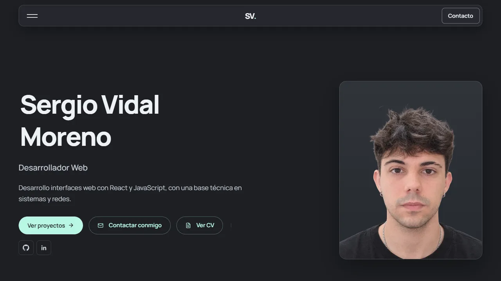

<div align="center">

# Sergio Vidal Moreno · Portfolio

**Portfolio personal de desarrollador web frontend, con React y Vite.**

[](https://github.com/GodSergio7/portfolio/actions/workflows/ci.yml)


[**Ver la web →**](https://www.sergiovidal.es)



</div>

---

## Índice

- [Sobre el proyecto](#sobre-el-proyecto)
- [Características](#características)
- [Resultados](#resultados)
- [Tecnologías](#tecnologías)
- [Empezar](#empezar)
- [Estructura del proyecto](#estructura-del-proyecto)
- [Cómo actualizar el contenido](#cómo-actualizar-el-contenido)
- [Decisiones técnicas](#decisiones-técnicas)
- [Despliegue y CI](#despliegue-y-ci)
- [Créditos y licencias de terceros](#créditos-y-licencias-de-terceros)
- [Contacto](#contacto)

## Sobre el proyecto

Web de una sola página que presenta mi perfil, las tecnologías que utilizo, mis proyectos, mi experiencia y formación, y mis datos de contacto.

El objetivo es que la web sea a la vez una carta de presentación y una muestra de trabajo. Por eso cuida el diseño y la accesibilidad, el rendimiento, el SEO y la calidad del código.

## Características

- **Diseño propio:**
  - identidad oscura con un único acento menta;
  - tipografía Manrope;
  - composición minimalista y simétrica;
  - adaptado a móvil, tablet y escritorio.
- **Componentes animados de [React Bits](https://reactbits.dev):**
  - menú Card Nav;
  - botones Star Border, Glare Hover y Specular;
  - nombre con Stroke Text;
  - foto con Flip Card;
  - carrusel de proyectos en móvil;
  - fondo Ghost Fibers.
- **HTML prerenderizado** en el build: buscadores y redes ven todo el contenido sin ejecutar JavaScript.
- **Accesible:**
  - enlace "Saltar al contenido";
  - foco visible;
  - menú usable con teclado;
  - zonas táctiles de 24 px;
  - textos alternativos;
  - respeto a `prefers-reduced-motion`.
- **SEO:**
  - URL canónica;
  - `sitemap.xml` y `robots.txt`;
  - datos estructurados Schema.org (`ProfilePage` + `Person`);
  - vista previa para redes (Open Graph);
  - alta en Google Search Console.
- **Analítica respetuosa:**
  - Google Analytics 4 solo con consentimiento;
  - banner de cookies con "Aceptar" y "Rechazar" al mismo nivel;
  - política de privacidad y cookies;
  - eventos de interés: ver el CV, copiar el email, abrir WhatsApp, GitHub o LinkedIn, abrir proyectos.
- **Carga por dispositivo:**
  - cada efecto se descarga solo donde se usa;
  - el fondo animado solo arranca si hay GPU y cuando la página ya ha cargado.
- **Detalles:**
  - CV en PDF;
  - copia del email al portapapeles;
  - imágenes adaptables (`srcset`);
  - página 404 propia.

## Resultados

Medidos con [PageSpeed Insights](https://pagespeed.web.dev) en https://www.sergiovidal.es:

| | Rendimiento | Accesibilidad | Buenas prácticas | SEO |
|---|:---:|:---:|:---:|:---:|
| **Ordenador** | 100 | 100 | 100 | 100 |
| **Móvil** | 94 | 100 | 100 | 100 |

## Tecnologías

| Área | Tecnologías |
|---|---|
| Base | React 19, Vite 8, JavaScript (JSX) |
| Estilos | CSS propio con *design tokens*, Bootstrap 5 compilado a medida desde Sass, Manrope (variable) |
| Animación y gráficos | GSAP, motion, ogl (WebGL) |
| Iconos | Lucide, Simple Icons, Devicon, Lobe Icons |
| Calidad | ESLint, GitHub Actions |
| Analítica y SEO | Google Analytics 4, Google Search Console, Schema.org |
| Despliegue | Vercel, dominio propio |

## Empezar

**Requisitos:** Node.js 20.19 o superior (lo pide Vite 8) y npm.

```bash
git clone https://github.com/GodSergio7/portfolio.git
cd portfolio
npm install
npm run dev
```

| Comando | Qué hace |
|---|---|
| `npm run dev` | Servidor de desarrollo con recarga en caliente. No prerenderiza. |
| `npm run build` | Build de producción: cliente, servidor y prerenderizado en `dist/`. |
| `npm run preview` | Sirve el build de producción en local. |
| `npm run lint` | Revisa el código con ESLint. |

## Estructura del proyecto

```
index.html                 # Página principal: SEO, Open Graph y datos estructurados
404.html                   # Página de error que sirve Vercel (sin React)
scripts/prerender.mjs      # Inserta el HTML prerenderizado en dist/index.html
public/                    # CV, imágenes, robots.txt, sitemap.xml, favicon
src/
├── main.jsx               # Arranque: hydrateRoot en producción, createRoot en desarrollo
├── entry-server.jsx       # Render en servidor para el prerenderizado
├── App.jsx                # Ensamblado de secciones
├── data/                  # Todo el contenido, separado de la vista
├── components/
│   ├── layout/            # Navbar, Footer (también la sección Contacto), Section, SiteBackground, CookieConsent
│   ├── sections/          # Hero, About, Technologies, Projects, Trajectory
│   └── ui/                # Button, TechIcon, SocialLinks, CardNav y reactbits/
├── hooks/                 # useMediaQuery, useHydrated, useActiveSection, useCopyToClipboard
├── lib/analytics.js       # Google Analytics, consentimiento y eventos
└── styles/                # index.css, bootstrap.scss, fonts.css
```

## Cómo actualizar el contenido

Casi todo se cambia editando `src/data/`, sin tocar los componentes.

| Quiero… | Qué hacer |
|---|---|
| Cambiar textos personales, contacto o habilidades | Editar `src/data/profile.js` |
| Añadir un proyecto | Añadir una entrada en `src/data/projects.js` y dos capturas en `public/proyectos/`: `nombre.webp` (1280 × 720) y `nombre-720.webp` (720 px de ancho, para móvil) |
| Añadir una tecnología | Añadir el nombre en `src/data/technologies.js` y su logo en el mapa `icons` de `src/components/ui/TechIcon.jsx` |
| Actualizar el CV | Sustituir `public/CV-Sergio-Vidal-Moreno.pdf` y cambiar el `?v=` de `profile.cv`, para que nadie vea la copia antigua guardada en caché |
| Cambiar la foto | Sustituir `public/foto-perfil.webp` (800 × 1067) y `public/foto-perfil-600.webp` |
| Añadir experiencia o formación | Editar `src/data/experience.js` o `src/data/education.js` |

## Decisiones técnicas

### Prerenderizado sin framework

`npm run build` genera el HTML de la página con `renderToString` (`src/entry-server.jsx`). Después, `scripts/prerender.mjs` hace tres cosas:

- lo inserta en `dist/index.html`;
- añade la precarga de la foto y de la fuente;
- escribe la fecha del build en el sitemap y en los datos estructurados.

En el navegador, React se engancha con `hydrateRoot`. Para que el HTML generado y el del navegador coincidan, se siguen tres reglas:

- **No se lee `window` ni `document` durante el render**, solo en efectos.
- `useMediaQuery` (`useSyncExternalStore`) vale `false` en el HTML generado y después toma el valor real.
- Lo que solo existe en el navegador se monta con `useHydrated()`. Ejemplos: la Flip Card, con carga diferida, y el año actual del footer.

### Rendimiento

- **Carga diferida por dispositivo** con `React.lazy`:
  - el Specular Button (WebGL) solo en escritorio;
  - el carrusel solo en móvil;
  - la Flip Card después de la hidratación.
- **Fondo Ghost Fibers:**
  - solo arranca si el navegador tiene **WebGL2 por GPU** (`failIfMajorPerformanceCaveat`);
  - espera a que la página haya cargado y el navegador esté libre;
  - va a 30 fps;
  - en los demás casos queda un fondo estático en CSS.
- **Bootstrap a medida** (`src/styles/bootstrap.scss`): solo la base, la rejilla y las utilidades que se usan.
- **Fuentes:** solo los subconjuntos latinos de Manrope, con precarga.
- **Imágenes:** en WebP, con versiones reducidas servidas mediante `srcset`.

### Analítica y privacidad

Google Analytics no se carga hasta que el visitante acepta las cookies. La elección se guarda en `localStorage` y se puede cambiar desde el enlace "Privacidad" del footer; al rechazar, se borran las cookies de Analytics.

Para medir un clic basta con añadir los atributos `data-*` mediante `trackProps({ evento: 'nombre', ... })` (`src/lib/analytics.js`).

## Despliegue y CI

- **Vercel** despliega automáticamente cada push a `main` en https://www.sergiovidal.es.
- **GitHub Actions** (`.github/workflows/ci.yml`) comprueba cada push y pull request con:
  - `npm ci`;
  - `npm audit --audit-level=high`;
  - `npm run lint`;
  - `npm run build`.

## Créditos y licencias de terceros

- **[React Bits](https://reactbits.dev)**, de David Haz: componentes Card Nav, Star Border, Glare Hover, Specular Button, Stroke Text, Carousel, Flip Card y Ghost Fibers. Licencia MIT + Commons Clause. Cada archivo adaptado conserva su aviso de licencia.
- **[Simple Icons](https://simpleicons.org)**: logos de tecnologías. CC0.
- **[Devicon](https://devicon.dev)**: logos de Java y Visual Studio Code. MIT.
- **[Lobe Icons](https://lobehub.com/icons)**: logos de Antigravity y ChatGPT. MIT.
- **[Lucide](https://lucide.dev)**: iconos de interfaz. ISC.
- **[Manrope](https://fonts.google.com/specimen/Manrope)**, servida con Fontsource. SIL Open Font License.

## Contacto

**Sergio Vidal Moreno**, desarrollador web frontend.

- Web: [sergiovidal.es](https://www.sergiovidal.es)
- LinkedIn: [Sergio Vidal Moreno](https://www.linkedin.com/in/sergio-vidal-moreno-5462b8364/)
- GitHub: [@GodSergio7](https://github.com/GodSergio7)
- Email: sergiovidalmoreno7@gmail.com
